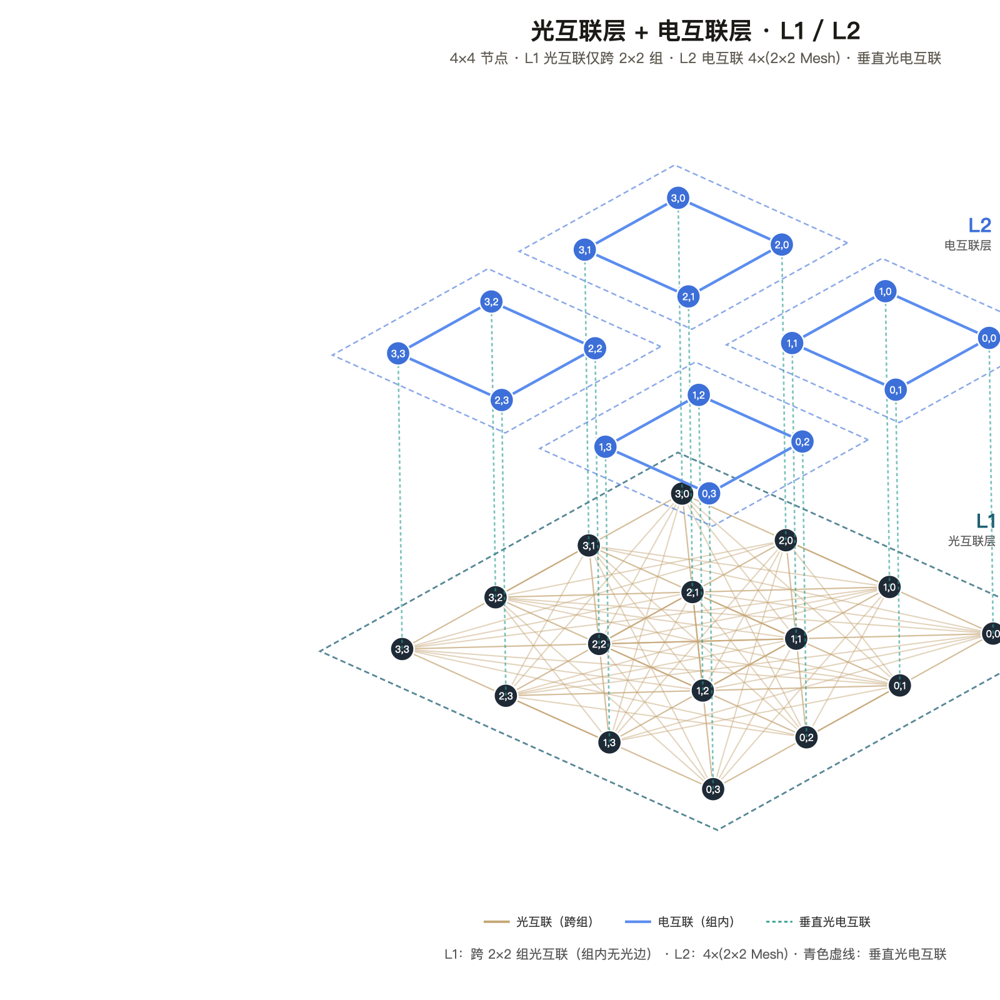

# JumperMesh

Clos `[66,66,66]` 逻辑交换在 **晶圆级 Mesh / NOW + 跳线层（Jumper）** 上的映射、路由与拓扑可视化工具集。

逻辑侧：三级 Clos，同 SSC id 共址；L1↔L2、L2↔L3 全连接 @ **200 Gbps**。  
物理侧：中心对称 2D Mesh `row_widths=(4,8,10,10,10,10,8,6)`（66 die），可叠加可配置的跳线层与垂直互联。

---

## 仓库内容

| 类别 | 文件 | 说明 |
| --- | --- | --- |
| 问题定义 | `PROBLEM_3D_MAPPING.md`、`PROBLEM_3D_LATENCY_MAPPING.md` | 3D mapping / 时延约束问题形式化 |
| 2D 基线 | `algorithm1_pairwise_exchange.py`、`ALGORITHM1_IO.md`、`RESULTS.md` | Clos→2D Mesh 映射与带宽结果 |
| 3D 拓扑 | `mesh3d.py` | NOW + 跳线层（none/single/dual/quad/full）可配置图 |
| 3D 优化 | `optimize_3d_mapping.py` | 时延上界下的 mapping / 路由 / 功耗；SA/GA/tighten |
| 报告 | `build_3d_report_html.py` | 汇总 HTML 对比报告 |
| 路由导出 | `export_logical_routes.py`、`filter_routes_by_path_len.py` | 逻辑边物理路径导出与过滤 |
| 带宽可视化 | `directed_mesh_bandwidth.py`、`render_mesh_bandwidth.py` | Mesh 有向负载图 |
| 拓扑绘图 | `draw_*.py` → `figures/` | Clos / 光–电互联示意图（见下） |

---

## 物理模型（默认）

| 层 | 几何 | 时延 | 容量（有向边，×200G） |
| --- | --- | ---: | ---: |
| NOW（\(z=0\)） | 2D Mesh 66 die | 80 ns | 350 |
| 跳线（\(z=1\)） | 窗口内独立 2D Mesh | 1 ns | 180 |
| 垂直 | 同 \((r,c)\) NOW↔跳线 | 5 ns | 250 |

跳线预设：`none` / `single` / `dual` / `quad` / `full`（窗口间不相连）。详情见 `PROBLEM_3D_LATENCY_MAPPING.md`。

---

## 快速开始

依赖：Python 3.10+（标准库即可跑核心脚本；绘图输出 SVG，可用系统工具转 PNG）。

```bash
# 2D Clos → Mesh 基线
python3 algorithm1_pairwise_exchange.py

# 3D mapping（示例：dual 跳线，二分搜最小 latency_max）
python3 optimize_3d_mapping.py --jumper-topo dual --out-dir results_dual

# 拓扑示意图
python3 draw_clos_logical_topology.py --png
python3 draw_opt_elec_topology.py --png
python3 draw_opt_topology.py --png
```

常用优化相关参数见：

```bash
python3 optimize_3d_mapping.py --help
```

---

## 拓扑图（`figures/`）

| 图 | 脚本 | 内容 |
| --- | --- | --- |
| `clos_logical_topology.*` | `draw_clos_logical_topology.py` | 三晶圆 L1/L2/L3 Clos 逻辑视图（Ø300 mm） |
| `opt_elec_topology.*` | `draw_opt_elec_topology.py` | **光互联层**（跨 2×2 组）+ **电互联层**（4×(2×2 Mesh)）+ 垂直光电互联 |
| `opt_topology.*` | `draw_opt_topology.py` | 仅光互联层 4×4，节点两两直连 |



---

## 2D 基线结果摘要

均匀 all-pairs @200G、最短路累加（见 `RESULTS.md`）：

| 量 | 值 |
| --- | ---: |
| \(C(M)\)（最热边逻辑条数） | 992 |
| 最热边带宽 | 198.4 Tbps |
| 说明 | 该需求下 \(C\) 与摆放无关 |

对应图：`best_alg1_200g_ports.png`。

---

## 文档索引

- [`ALGORITHM1_IO.md`](ALGORITHM1_IO.md) — Algorithm 1 输入输出约定  
- [`PROBLEM_3D_MAPPING.md`](PROBLEM_3D_MAPPING.md) — 3D mapping 问题定义  
- [`PROBLEM_3D_LATENCY_MAPPING.md`](PROBLEM_3D_LATENCY_MAPPING.md) — NOW+跳线时延约束与功耗  
- [`RESULTS.md`](RESULTS.md) — 2D 基线数值摘要  

---

## 许可

研究代码，默认保留所有权利；如需开源许可请另行声明。
